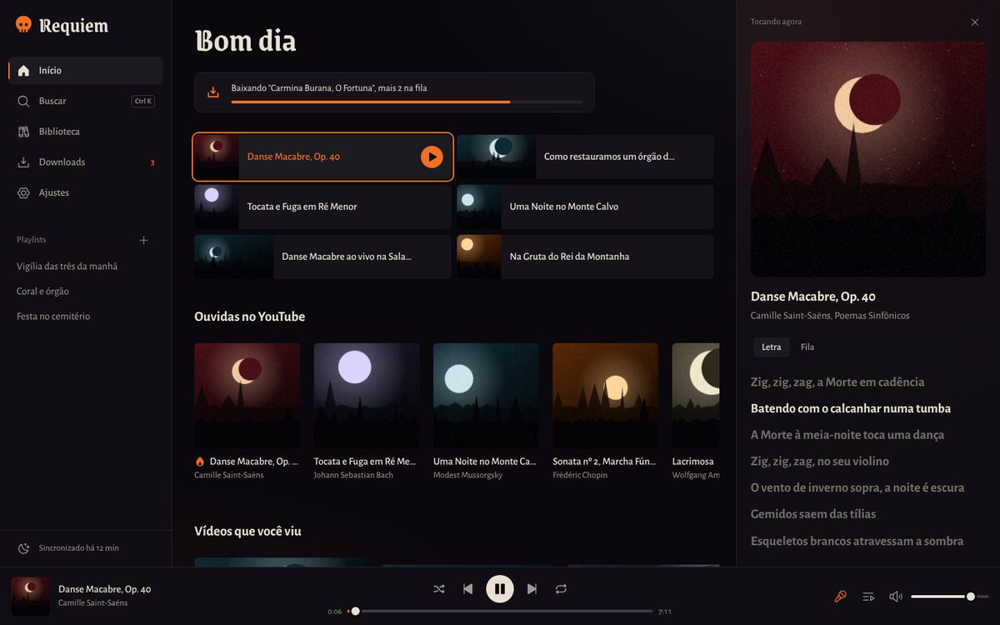
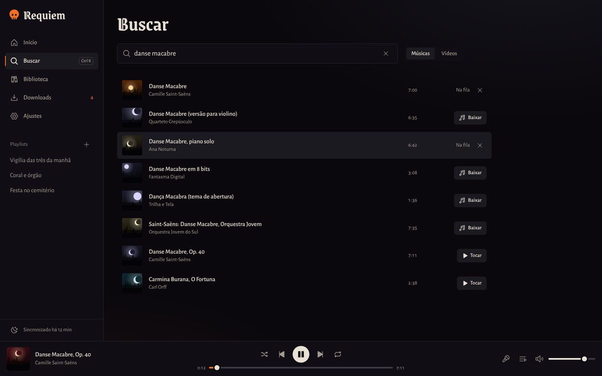
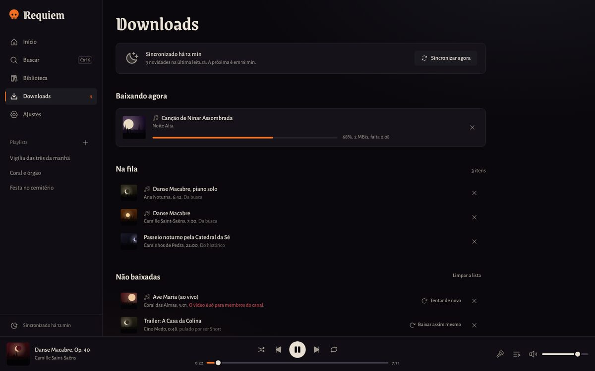
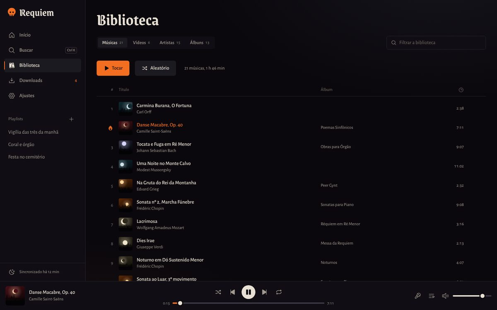
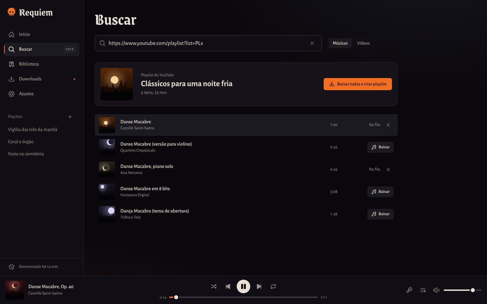

# Requiem

App de computador que guarda o que você ouve no YouTube. Ele lê o seu histórico e as suas
curtidas, baixa sozinho as músicas e os vídeos novos, e toca tudo offline, num player escuro,
rápido e sem anúncios. Qualquer outra música você busca e baixa dentro do próprio app.

Windows, macOS e Linux. Feito em Rust ([Tauri 2](https://tauri.app)) com a interface em React.

<p>
  
</p>

## O que ele faz

- **Baixa sozinho o que você ouve.** A cada 15 min, 30 min, 1 h ou 3 h, lê o histórico, os
  vídeos curtidos e as músicas curtidas no YouTube Music. O que for música vira áudio (M4A ou
  MP3), o resto vira vídeo (até 1440p). Shorts, transmissões ao vivo e vídeos longos demais ficam
  de fora, e cada regra é ajustável. O que ficou de fora aparece em Downloads com "Baixar assim
  mesmo".
- **Baixa qualquer música.** A busca procura no YouTube e mostra artista e duração de cada
  resultado; em Músicas, Shorts e mixes de uma hora vão para o fim. Também aceita um link de
  vídeo ou de playlist colado: uma playlist inteira vira playlist no Requiem com um clique.
- **Toca tudo offline.** Fila, aleatório, repetição, letras sincronizadas do
  [LRCLIB](https://lrclib.net), vídeos no painel ou em tela cheia, teclas de mídia do teclado,
  controles na bandeja do sistema, e continua de onde parou.
- **Organiza sem pedir nada.** "Artista - Música (Official Video)" vira título e artista
  limpos. Quando o YouTube Music informa faixa, artista e álbum, a biblioteca usa esses dados e
  monta as páginas de artista e de álbum.
- **Mostra o que já está no computador.** Lê a sua pasta Música (e as outras que você
  escolher em Ajustes) e põe na biblioteca as músicas e os vídeos que já estão lá, com capa,
  artista e álbum tirados das tags. Os arquivos ficam onde estão: tirar uma dessas músicas da
  biblioteca nunca apaga o arquivo.
- **Os arquivos são seus.** Ficam em `Música/Requiem` (ou na pasta que você escolher), em
  `Músicas` e `Vídeos`, com o nome "Artista - Título [id].m4a". Qualquer outro player abre.

<p>
  
  
</p>
<p>
  
  
</p>

As imagens acima são da prévia no navegador, com dados de exemplo e capas geradas. No app de
verdade, as capas são as miniaturas do YouTube.

## Instalar

Os instaladores saem do GitHub Actions a cada mudança (workflow "Requiem Desktop") e vão para
a página de releases quando uma versão é aprovada.

- **Windows:** `Requiem-Windows.exe`. O app não tem assinatura paga, então o Windows pode
  avisar que ele é desconhecido: clique em **Mais informações** e depois em **Executar assim
  mesmo**.
- **macOS:** `Requiem-Mac.dmg` (Intel e Apple Silicon). Arraste para Aplicativos. Na primeira
  vez, clique com o botão direito no Requiem e escolha **Abrir**. Se o macOS disser que o app
  está danificado, rode `xattr -cr /Applications/Requiem.app` no Terminal.
- **Linux:** `Requiem-Linux.AppImage` (marque como executável e abra) ou `requiem-linux.deb`.

Na primeira abertura, o Requiem baixa o motor: [yt-dlp](https://github.com/yt-dlp/yt-dlp),
[Deno](https://deno.com) (que o yt-dlp usa para os desafios do YouTube) e
[FFmpeg](https://ffmpeg.org). São uns 150 MB de download, uma vez só. O yt-dlp se atualiza sozinho uma vez
por dia, porque o YouTube muda o tempo todo.

## Conectar o YouTube

A busca funciona sem conta. Para o Requiem ler o seu histórico e as suas curtidas, conecte o
YouTube em **Ajustes**, de um destes jeitos:

1. **Entrar pelo app** (o mais simples). Abre a página de login do Google numa janela do
   Requiem. A senha vai direto para o Google. O Requiem guarda só os cookies da sessão, num
   arquivo que só a sua conta do computador lê.
2. **Usar o login do navegador.** O yt-dlp lê a sessão já aberta no navegador a cada
   sincronização. Funciona melhor com o Firefox. No Windows, o Chrome e o Edge protegem os
   cookies e costumam falhar.
3. **Importar um `cookies.txt`** exportado por uma extensão do navegador.

O botão **Testar** lê os cinco vídeos mais recentes do seu histórico para provar que deu certo.
O histórico do YouTube precisa estar ativado na sua conta.

## Atalhos

| Tecla | Faz |
|---|---|
| Espaço | Tocar ou pausar |
| Ctrl + seta para a direita ou esquerda | Próxima ou anterior |
| Shift + seta para a direita ou esquerda | Avançar ou voltar 10 segundos |
| Ctrl + seta para cima ou para baixo | Volume |
| Ctrl + K | Buscar |
| L, Q | Letra, fila |
| F | Tela cheia (vídeos) |
| M | Silenciar |
| Alt + seta para a esquerda | Voltar |

## Como é feito

```
requiem/
  core/        motor em Rust, sem janela: banco SQLite, sincronização, fila de downloads,
               yt-dlp, servidor local de mídia, letras, leitura das pastas de música.
               76 testes, entre eles um que baixa com um yt-dlp de mentira e confere
               que a música chega à biblioteca e toca.
  src-tauri/   a casca do app: janela, bandeja, comandos, login do YouTube.
  src/         a interface em React (Vite, Tailwind, Radix, Phosphor).
```

- O motor conversa com o yt-dlp como processo separado. Primeiro lê as informações do vídeo,
  decide se é música ou vídeo, e então baixa a partir da mesma leitura.
- A mídia chega à interface por um servidor HTTP local, só em `127.0.0.1`, com um token
  aleatório por sessão e suporte a Range (para pular para qualquer ponto da música).
- Um só elemento de vídeo toca músicas e vídeos, então a fila, os controles e as teclas de
  mídia são os mesmos para os dois.

### Rodar e testar

```bash
cd requiem
npm ci
npm run dev                 # prévia no navegador com dados de exemplo
npx tauri dev               # o app de verdade
cargo test -p requiem-core  # testes do motor
cargo test -p requiem-core -- --ignored online_   # instala o motor e baixa do YouTube de verdade
```

No Linux, o app precisa de `libwebkit2gtk-4.1-dev`, `libayatana-appindicator3-dev`,
`librsvg2-dev` e dos plugins do GStreamer (`gstreamer1.0-plugins-good`, `gstreamer1.0-libav`).

O CI instala o `.deb` numa máquina limpa e deixa o app percorrer as próprias telas
(`REQUIEM_TOUR=1`): primeira abertura, busca, uma música baixada tocando com letra, um vídeo,
biblioteca e ajustes. Com `[screenshots]` na mensagem do commit, as capturas vão para
`docs/screenshots`.

## Uso responsável

Guarde só o que você tem direito de guardar, para ouvir você mesmo. Os Termos de Serviço do
YouTube restringem downloads, e as leis de direito autoral variam de país para país. Quem faz a
música agradece quando você também ouve nos canais oficiais.

## Licenças

- Código do Requiem: MIT.
- Fontes [Grenze Gotisch](https://fonts.google.com/specimen/Grenze+Gotisch) e
  [Alegreya Sans](https://fonts.google.com/specimen/Alegreya+Sans): SIL Open Font License
  (arquivos em `public/fonts`).
- Ícones [Phosphor](https://phosphoricons.com): MIT.
- O yt-dlp (Unlicense), o Deno (MIT) e o FFmpeg (LGPL/GPL) não vêm dentro do app: são baixados
  dos projetos oficiais na primeira abertura.
