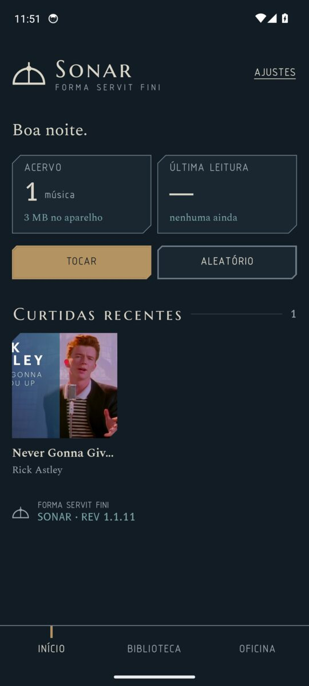
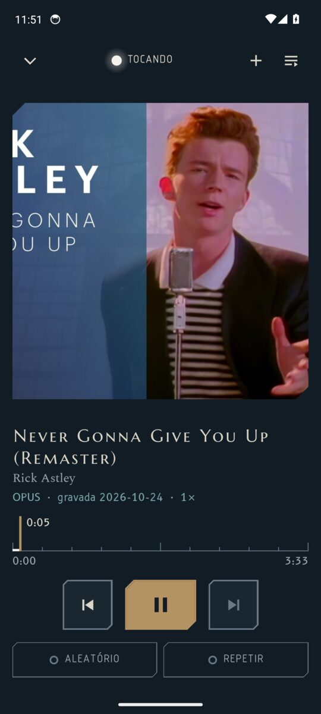
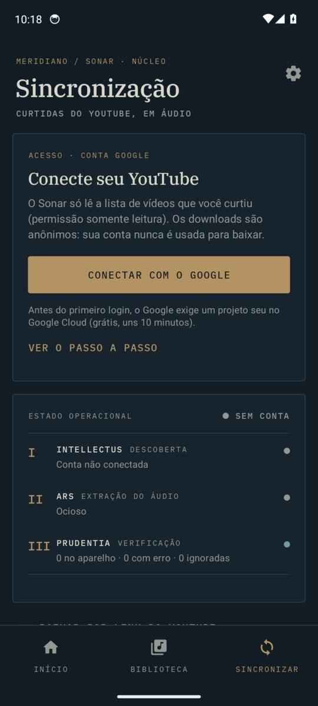

# Sonar

App Android pessoal que encontra os vídeos que você curtiu no YouTube, baixa o áudio das
músicas e toca tudo offline, num player limpo, sem anúncios.

- **Descobre as curtidas** pela YouTube Data API oficial, com permissão somente leitura.
- **Baixa em áudio** com o [yt-dlp](https://github.com/yt-dlp/yt-dlp) rodando no próprio
  celular (via [youtubedl-android](https://github.com/yausername/youtubedl-android)), em Opus,
  M4A ou MP3. Os downloads são anônimos: a conta Google nunca é usada para baixar.
- **Filtra o que é música**: só a categoria Música do YouTube, sem Shorts e sem vídeos longos
  (tudo ajustável). O que ficou de fora aparece em "Ignoradas", com "Baixar mesmo assim".
- **Organiza os nomes**: "Artista - Música (Official Video)" vira título e artista limpos;
  quando o YouTube Music informa faixa, artista e álbum, o Sonar usa esses dados.
- **Sincroniza sozinho** em segundo plano (a cada 3, 6, 12 ou 24 h), só no Wi-Fi se você quiser.
- **Compartilhar → Sonar**: no app do YouTube ou do YouTube Music, toque em Compartilhar e
  escolha "Baixar no Sonar" para baixar qualquer música, mesmo sem curtir. Também dá para colar
  um link em Oficina → "Baixar por link". Isso funciona sem configurar o Google Cloud.
- **Player**: tela inicial com curtidas recentes, mais tocadas, artistas e "Redescubra";
  biblioteca com busca sem acentos; playlists; fila; aleatório e repetir; controles na
  notificação e na tela de bloqueio; continua de onde parou.
- Opcional: salva uma cópia em `Música/Sonar` para outros players.

<p>
  
  
  
</p>

Capturas feitas pelo teste automático no emulador, com um vídeo público de teste.

## Identidade visual: MERIDIANO

O Sonar segue o sistema de design Meridiano. *Forma servit fini*: a forma serve à finalidade,
e cada tela declara a sua.

- **O edifício.** Biblioteca, oficina e observatório num só prédio: *Bibliotheca* guarda e
  encontra as músicas, *Officina* lê as curtidas e extrai o áudio, o player é o observatório.
  Os nomes são inscrições latinas (V no lugar de U); rótulos, botões e mensagens são em
  português, com comandos no infinitivo ("Sincronizar", "Ver oficina").
- **Cor com significado.** Grafite domina; marfim é texto. Luz (`aceso`) só indica operação:
  a lâmpada da música que toca, o trecho medido de uma régua. Bronze (`insignia`) marca a ação
  principal de cada tela, o traço de trânsito e os selos. Pátina (`tempo`) é o que passou:
  datas, revisões, referências. Alerta só em estado crítico, sempre com lâmpada quadrada e
  palavra. Dois temas: Meia-noite (padrão) e Meio-dia, em Ajustes.
- **Quatro vozes.** Marcellus SC (Capitalis) para nomes e títulos; Spectral (Humanistica) para
  o texto; osifont, a letra ISO 3098 do desenho técnico (Norma), sempre em maiúsculas, para
  rótulos e botões; B612 (Instrumentum) para todo número que se compara.
- **Peças usinadas.** Quinas retas e chanfro de 45° nos cantos superior esquerdo e inferior
  direito, espaços em passos de √2, sem sombras nem degradês.
- **Instrumentos.** Estado é sempre lâmpada mais palavra (aceso, repouso, atenção, crítico,
  verificado). Progresso é uma régua graduada com o traço de trânsito, inclusive a posição da
  música no player. Leituras trazem valor, unidade e referência. A oficina é um console com as
  faculdades *Intellectvs* (ler as curtidas), *Prvdentia* (julgar o que é música) e *Ars*
  (extrair o áudio), um poço de registro e o selo *Probatvm*, emitido só quando todas as
  músicas aceitas estão no aparelho. Ajustes terminam na placa de identificação do app.
- **Marca.** O sinal do meridiano (arco sobre o horizonte, eixo de trânsito e disco do
  meio-dia) é o ícone; o emblema graduado aparece nos estados vazios.
- **Licenças das fontes** em `licenses/`: Marcellus SC, Spectral e B612 sob SIL OFL; osifont
  sob LGPL 3 com exceção de fonte.

## Instalar

No celular, abra **[Sonar.apk](https://github.com/JVCSampaio/JVCSampaio/releases/download/sonar-latest/Sonar.apk)**
e toque em **Instalar**; o Android pede para permitir a instalação de apps desta fonte.
Celulares muito antigos (32 bits) usam
[Sonar-celular-antigo.apk](https://github.com/JVCSampaio/JVCSampaio/releases/download/sonar-latest/Sonar-celular-antigo.apk).

O link aponta sempre para a última versão aprovada, que passou no teste do emulador
([página da versão](https://github.com/JVCSampaio/JVCSampaio/releases/tag/sonar-latest)).
Cada versão nova instala por cima da anterior, mantendo músicas e playlists.

## Configurar o acesso ao YouTube (uma vez, uns 10 minutos)

O Google exige que cada app que lê dados do YouTube tenha um projeto no Google Cloud. É
grátis e a cota diária sobra (cada 50 curtidas gastam 1 de 10.000 unidades).

1. Entre em <https://console.cloud.google.com> e crie um projeto (ex.: "Sonar").
2. Em **APIs e serviços → Biblioteca**, procure **YouTube Data API v3** e clique em **Ativar**.
3. Em **Google Auth Platform** (antiga "Tela de permissão OAuth"), clique em **Começar**:
   nome do app "Sonar", seu e-mail, público **Externo**.
4. Em **Público-alvo**, adicione seu Gmail em **Usuários de teste**.
   Dica: em modo de teste o Google pode pedir login de novo a cada 7 dias. Para evitar,
   clique em **Publicar app** (não precisa enviar para verificação; só aparece o aviso
   "app não verificado" no login).
5. Em **Clientes → Criar cliente**, escolha **Android** e preencha:
   - Nome do pacote: `io.github.jvcsampaio.sonar`
   - Impressão digital SHA-1: `56:A1:65:EC:80:DA:0E:99:A6:3D:A6:2C:26:8E:95:3D:2E:D5:0E:CC`
6. No celular, abra o Sonar → **Oficina → Conectar com o Google**, escolha sua conta,
   toque em **Avançado → Ir para Sonar** se aparecer o aviso de app não verificado, e permita
   ver sua conta do YouTube.

Pronto: o Sonar lista as curtidas e começa a baixar. Na primeira vez ele atualiza o yt-dlp
antes do primeiro download.

Se o login falhar com "erro 10", o nome do pacote ou o SHA-1 do cliente Android não confere.

## Chave de assinatura

`keystore/sonar.jks` assina os APKs. Ela está no repositório de propósito: o SHA-1 precisa
ser sempre o mesmo para o login do Google funcionar e para cada build instalar por cima do
anterior. Para usar uma chave privada, defina `SONAR_KEYSTORE_FILE`, `SONAR_KEYSTORE_PASSWORD`,
`SONAR_KEY_ALIAS` e `SONAR_KEY_PASSWORD` no build e cadastre o novo SHA-1 no Google Cloud.

## Teste no emulador

A cada push, o GitHub Actions instala o APK num emulador Android, abre as telas principais,
compartilha um vídeo de teste (licença Creative Commons) com o app, espera o yt-dlp baixar e
toca a música. O job falha se o app travar. Com `[screenshots]` na mensagem do commit, as
capturas vão para `docs/screenshots/`. A versão só é publicada no link de download com
`[release]` na mensagem do commit ou rodando o workflow à mão, depois da aprovação.

## Compilar

Precisa do JDK 17 e do Android SDK (API 35).

```bash
./gradlew :app:testReleaseUnitTest :app:assembleRelease
```

Os APKs saem em `app/build/outputs/apk/release/`.

## Como funciona

```
YouTube Data API ── videos.list?myRating=like ──▶ LikeSync ──▶ Room (tracks)
                                                     │  MetadataCleaner + TrackFilter
                                                     ▼
WorkManager ── DownloadWorker ── yt-dlp + ffmpeg ──▶ arquivo .opus/.m4a/.mp3 + capa
                                                     │
Media3 PlaybackService ◀── MediaController ◀── Compose UI (início, biblioteca, player)
```

| Pasta | Conteúdo |
| --- | --- |
| `data/` | Room, ajustes (DataStore), API do YouTube, login Google, armazenamento |
| `domain/` | limpeza de título/artista e filtros (Kotlin puro, com testes) |
| `download/` | yt-dlp, capas, exportação para a pasta Música |
| `sync/` | sincronização das curtidas e fila de downloads (WorkManager) |
| `playback/` | serviço de mídia e conexão do player |
| `ui/` | telas em Jetpack Compose |

## Uso responsável

O Sonar é para uso pessoal. Baixar conteúdo do YouTube pode contrariar os termos do serviço e
os direitos dos artistas; use só com o que você tem direito de ouvir offline e apoie quem você
escuta.
